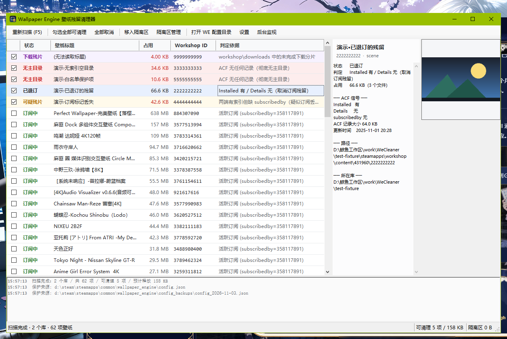

# Wallpaper Engine Leftover Cleaner

**Reclaim the disk space Steam forgot to free after you unsubscribed.**

A small Windows utility that finds workshop wallpapers still sitting in
`steamapps\workshop\content\431960\` after the subscription is gone, tells you *why* it thinks
each one is orphaned, and removes them — reversibly.



<p align="center">
  
</p>

| | |
|---|---|
| **Platform** | Windows 10 / 11, x64 |
| **Requires** | .NET Framework 4.8 (ships with Windows 10 1903+) — no .NET SDK, no installer |
| **Binary** | single ~120 KB `.exe` |
| **License** | MIT |

> The UI and CLI output are currently **Simplified Chinese only**. The classification itself is
> language-independent, and `scan --json` gives machine-readable output. PRs adding i18n are very
> welcome. 中文说明见 [README.zh-CN.md](README.zh-CN.md).

---

## The actual problem

Wallpaper Engine does not delete workshop content when you unsubscribe — Steam does, and it is
unreliable about it. Unsubscribing rewrites `appworkshop_431960.acf` and drops the item from one
section but not the other:

```
"AppWorkshop"
{
    "WorkshopItemsInstalled"     ← "what Steam thinks is on disk"
    {  "3368529063" { "size" "113188922" ... }  }

    "WorkshopItemDetails"        ← "what you are actually subscribed to"
    {  "884307090" { "subscribedby" "358117891" ... } }
}
```

Unsubscribing pulls the entry out of `WorkshopItemDetails`. The `WorkshopItemsInstalled` record and
the `content\431960\<id>\` directory usually stay behind. Wallpaper Engine no longer lists the item,
so nothing in either UI ever tells you the files are there.

Measured on a real library that had never been cleaned: **73 items / 2.55 GB, of which 14 items
(375 MB) were pure leftovers.**

And it is not only a "Steam never cleans up" problem — Steam sometimes *does* clean up, but stops
halfway. In that same library, after Steam ran its own pass, two directories were left behind
containing `project.json`, `preview.*` and stray assets, with `scene.pkg` already deleted. The ACF
knew nothing about them any more.

## How it decides

Three sources are cross-checked: the ACF, the filesystem, and Wallpaper Engine's own `config.json`.

| Status | Condition | Cleaned by default |
|---|---|---|
| **Subscribed** | `WorkshopItemDetails` has a live `subscribedby` | no |
| **Protected** | Referenced by the *current* WE `config.json`, or in your keep-list | no |
| **In favorites** | Unsubscribed, but still in WE's `explore.favorites` | no |
| **Backup hint** | Unsubscribed, only appears in `config_backups\*.json` | no |
| **Unsubscribed** | In `Installed`, missing from `Details` | **yes** |
| **No owner** | Directory on disk, absent from both ACF sections | **yes** |
| **Suspicious** | Present in both sections but no `subscribedby` | **yes** |
| **Download fragment** | Unfinished download under `workshop\downloads\431960\` | **yes** |
| Index only | In ACF, directory already gone (takes no space) | — |

**Unsubscribed** is the strongest signal: Steam has already disowned the subscription, yet both the
install record and the files remain.

Cross-checking matters. In the real library above, two items (`3148204491`, 265 MB and
`3785121691`, 25.8 MB) were also missing from `WorkshopItemDetails` — but the current WE config
still referenced them in `wproperties`, so they are classified **Protected** and never touched.
Judging by the ACF alone would have deleted wallpapers that were in active use.

## Safety

Deleting gigabytes on someone's behalf needs more than a confirmation dialog:

1. **Quarantine first.** Files move to
   `%LOCALAPPDATA%\WallpaperEngineLeftoverCleaner\quarantine\<batch>\` with a `manifest.json`
   recording the original path, size, status and reasoning.
2. **One-command rollback.** `restore --batch latest`, or the button in the quarantine manager.
3. **Verified cross-volume moves.** When the quarantine lives on another drive, the directory is
   copied to a `.partial` sibling first, file count and total byte size are compared, and only then
   is the source deleted. Any failure keeps the original untouched.
4. **Keep-list.** `keep add <id>` outranks every heuristic.
5. **Running-process check.** If `wallpaper32.exe` / `wallpaper64.exe` is alive, it warns before
   moving files that may be memory-mapped.
6. **Recycle bin.** Permanent deletion prefers the recycle bin and falls back to a hard delete.

## Usage

### GUI

Double-click `WeCleaner.exe`. It scans on start; already-unsubscribed leftovers are pre-checked and
tinted red. Pick what you want, then **move to quarantine**.

The right pane shows the preview image and the full ACF signal breakdown (`Installed` / `Details` /
`subscribedby`) for the selected item, so every decision is auditable.

Right-click for: add to keep-list, reveal in Explorer, open the workshop page, copy ID, copy full
path.

**Background monitoring** minimises to the tray and watches every library's `.acf`; when it changes
it rescans and, if the orphan count grew, shows a balloon.

### CLI

```powershell
WeCleaner.exe                        # GUI
WeCleaner.exe scan                   # table output
WeCleaner.exe scan --json --out r.json
WeCleaner.exe quarantine --dry-run --all
WeCleaner.exe quarantine --all -y
WeCleaner.exe quarantine --id 3368529063,3576135309 -y
WeCleaner.exe batches
WeCleaner.exe restore --batch latest
WeCleaner.exe purge --batch latest -y         # recycle bin first
WeCleaner.exe purge --batch latest -y --hard  # permanent
WeCleaner.exe keep add 3148204491
WeCleaner.exe keep list
WeCleaner.exe paths                  # detected libraries + WE configs
WeCleaner.exe tray                   # tray only, no window
WeCleaner.exe shellopen <path>       # diagnose the Shell/reveal path
```

`--lib <dir>` adds an extra Steam library root (a directory containing `steamapps`) to the scan.

Exit codes: `0` ok · `1` bad arguments / target · `2` runtime failure.

### Deletion is two steps

Disk space is only reclaimed by the second step:

```powershell
WeCleaner.exe quarantine --all -y     # moves out of workshop\content, still on disk
WeCleaner.exe purge --batch latest -y # actually deletes
```

Step one is atomic per directory and fully reversible; step two is where the bytes come back.

## Build

No SDK, no NuGet, no MSBuild — just the C# compiler that already exists on every Windows box:

```powershell
powershell -NoProfile -ExecutionPolicy Bypass -File .\build.ps1
# -> dist\WeCleaner.exe
```

The source is intentionally **C# 5**, because `%WINDIR%\Microsoft.NET\Framework64\v4.0.30319\csc.exe`
only speaks C# 5. That constraint keeps the build reproducible on any Windows 10/11 machine with
zero setup.

```
src/
  Kv.cs           Valve KeyValues (ACF / VDF) parser
  Json.cs         minimal JSON reader/writer (no System.Web.Extensions dependency)
  Steam.cs        library discovery: registry + libraryfolders.vdf, multi-drive
  Scanner.cs      orphan classification, project.json metadata, data-dir resolution
  Quarantine.cs   move / restore / purge, with verified cross-volume copies
  Settings.cs     persisted options
  Native.cs       console attach, SHFileOperation, OLE, Shell reveal with tiered fallback
  Ui.cs           main window
  UiDialogs.cs    quarantine manager, settings, tray watcher
  Program.cs      entry point + CLI
  AssemblyInfo.cs version metadata
  app.manifest    asInvoker / PerMonitorV2 / longPathAware
tools/make-icon.py  regenerates assets/icon.ico
```

### Regression fixture

`make-fixture.ps1` builds a throwaway Steam library covering subscribed / unsubscribed / no-owner /
missing-`subscribedby` / download-fragment / non-numeric directory, so the whole
quarantine → restore → purge cycle can be exercised without touching a real installation.

```powershell
.\make-fixture.ps1
.\dist\WeCleaner.exe scan --lib .\test-fixture
.\dist\WeCleaner.exe quarantine --id 2222222222,3333333333 -y --lib .\test-fixture
.\dist\WeCleaner.exe restore --batch latest
```

CI runs exactly that sequence on every push.

## Known limitations

- **Wallpaper Engine has no plugin API.** Its `plugins\` folder only loads native DLLs (currently
  just the bundled `ledextensions64.dll`), and web wallpapers run in a CEF sandbox that cannot see
  Steam's subscription index. This is therefore an external tool that *cooperates* with WE — it
  reads its config for the protected set, watches the ACF for changes, and checks whether
  `wallpaper32/64.exe` is running — rather than something loaded into it.
- **A running WE may have a stale `config.json`.** The protection set is whatever was last flushed
  to disk. For maximum caution, quit WE before cleaning.
- **Multi-account libraries.** If another Steam account on the same machine subscribes to the same
  item, `subscribedby` carries their SteamID and the item is correctly kept.
- **`projects\myprojects\` is never touched** — those are your own creations, not subscriptions.
- **The ACF is never modified.** It is read-only input; every destructive action happens at the
  filesystem level, which keeps Steam's subscription index consistent.
- **GIF previews show as a still frame.** Previews are decoded into an independent `Bitmap` so
  nothing keeps a file stream open; as a side effect animations do not play.
- **Revealing a file in Explorer is tiered.** `SHOpenFolderAndSelectItems` (selects, spawns
  nothing) → `ShellExecute("open", folder)` (reuses the running explorer, spawns nothing) →
  `explorer.exe /select` (selects, but spawns a process — **off by default**). On machines with
  HIPS/AV shell hooks the first two can return `E_ACCESSDENIED`; the tool then copies the path to
  the clipboard and logs the per-tier `HRESULT` instead of failing silently.
- **Never use `Process.Start("explorer.exe", ...)` for file reveal.** Each call spawns a new
  explorer process; two in quick succession can fail during loader init and surface a system-level
  `explorer.exe — 0xc0000142` dialog. With `AutoRestartShell=1` the failed shell keeps getting
  restarted, so the dialogs cascade. That is why the third tier is opt-in.

## Contributing

Bug reports benefit enormously from the diagnostic block — see the issue template. Include the
output of `WeCleaner.exe paths` and `WeCleaner.exe scan --json`.

## License

MIT — see [LICENSE](LICENSE).
