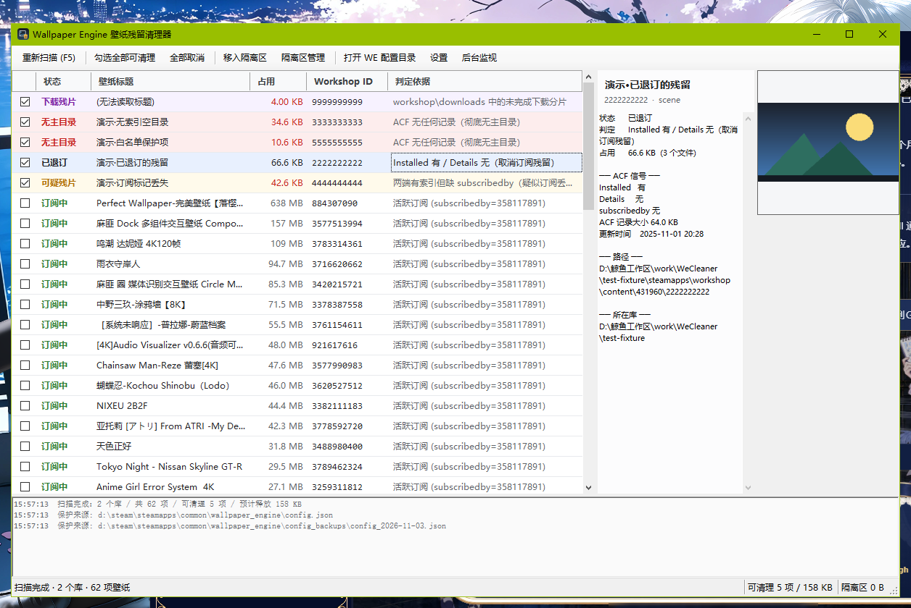

# Wallpaper Engine 壁纸残留清理器

**把 Steam 忘了释放的磁盘空间拿回来。**



| | |
|---|---|
| **平台** | Windows 10 / 11 x64 |
| **依赖** | .NET Framework 4.8（Win10 1903+ 自带）—— 不需要 .NET SDK，不需要安装程序 |
| **体积** | 单个约 120 KB 的 exe |
| **许可** | MIT |

英文说明见 [README.md](README.md)。

---

## 问题出在哪

Wallpaper Engine 取消订阅后，真正干活的是 Steam，而 Steam 干得不干净。取消订阅时，它会把条目从
`appworkshop_431960.acf` 的一个段落里删掉，但不删另一个：

```
"AppWorkshop"
{
    "WorkshopItemsInstalled"     ← Steam 认为「磁盘上装着什么」
    {  "3368529063" { "size" "113188922" ... }  }

    "WorkshopItemDetails"        ← Steam 认为「你在订阅什么」
    {  "884307090" { "subscribedby" "358117891" ... } }
}
```

退订只把条目从 `WorkshopItemDetails` 里摘掉，`WorkshopItemsInstalled` 记录和
`content\431960\<id>\` 目录通常原样留着。WE 界面已经不显示这个壁纸了，所以两个界面都不会
告诉你文件还在。

在一个从未清理过的真实库上实测：**73 个壁纸 / 2.55 GB，其中 14 个、375 MB 是纯残留。**

而且这不止是「Steam 从不清理」——有时 Steam 会清理，但**清到一半就停了**。同一个库里，
Steam 自己跑过一轮之后，有两个目录被留下：`scene.pkg` 已经删了，`project.json`、`preview.*`
和零散素材还在，而 ACF 里已经完全没有它们的记录。

## 判定逻辑

三方交叉比对：ACF、文件系统、Wallpaper Engine 自己的 `config.json`。

| 状态 | 条件 | 默认勾选 |
|---|---|---|
| **订阅中** | `WorkshopItemDetails` 里有有效 `subscribedby` | ✗ |
| **保护** | 当前 WE `config.json` 仍引用，或在保留白名单里 | ✗ |
| **收藏夹** | 已退订，但还在 WE 的 `explore.favorites` 里 | ✗ |
| **历史引用** | 已退订，仅出现在 `config_backups\*.json` 中 | ✗ |
| **已退订** | `Installed` 有、`Details` 无 | ✓ |
| **无主目录** | 磁盘有目录，ACF 两个段落都没有记录 | ✓ |
| **可疑残片** | 两个段落都有，但没有 `subscribedby` | ✓ |
| **下载残片** | `workshop\downloads\431960\` 下的未完成分片 | ✓ |
| 仅索引 | ACF 有记录但磁盘无目录（不占空间，仅展示） | — |

「已退订」是最强信号：Steam 已经否认了这条订阅，但安装记录和文件都还在。

交叉验证很关键。上面那个真实库里，`3148204491`（265 MB）和 `3785121691`（25.8 MB）也不在
`WorkshopItemDetails` 里，但当前 WE 配置的 `wproperties` 仍引用它们，所以被判为**保护**，
不会动。只看 ACF 会把正在用的壁纸删掉。

## 安全设计

替别人删几个 GB 的文件，光有确认框不够：

1. **先隔离，不直接删。** 文件移到
   `%LOCALAPPDATA%\WallpaperEngineLeftoverCleaner\quarantine\<批次>\`，附 `manifest.json`
   记录原路径、大小、状态和判定依据。
2. **一条命令回滚。** `restore --batch latest`，或隔离区管理界面里的按钮。
3. **跨卷移动有校验。** 隔离区在另一个驱动器时，先复制到 `.partial` 兄弟目录，比对文件数和
   总字节完全一致才替换、才删源；任何一步失败都保留原文件。
4. **保留白名单。** `keep add <id>` 优先级高于一切启发式规则。
5. **占用检测。** 检测到 `wallpaper32.exe` / `wallpaper64.exe` 在跑会先提醒。
6. **回收站。** 彻底删除优先走回收站，失败才硬删。

## 使用

### 图形界面

双击 `WeCleaner.exe`。启动即扫描，已退订的残片默认勾选、标红。选好后点第二个工具栏按钮
**移入隔离区**。

右侧面板显示预览图和该条目完整的 ACF 信号（`Installed` / `Details` / `subscribedby`），
每一次判定都可追溯。

右键菜单：加入保留白名单、在资源管理器中定位、打开创意工坊页面、复制 ID、复制完整路径。

**后台监视**会最小化到托盘，盯着每个库的 `.acf`；内容一变就重扫，发现残留变多就弹气泡。

### 命令行

```powershell
WeCleaner.exe                        # 图形界面
WeCleaner.exe scan                   # 表格输出
WeCleaner.exe scan --json --out r.json
WeCleaner.exe quarantine --dry-run --all
WeCleaner.exe quarantine --all -y
WeCleaner.exe quarantine --id 3368529063,3576135309 -y
WeCleaner.exe batches
WeCleaner.exe restore --batch latest
WeCleaner.exe purge --batch latest -y         # 优先回收站
WeCleaner.exe purge --batch latest -y --hard  # 永久删除
WeCleaner.exe keep add 3148204491
WeCleaner.exe keep list
WeCleaner.exe paths                  # 显示探测到的库与 WE 配置
WeCleaner.exe tray                   # 只起托盘，不进主窗口
WeCleaner.exe shellopen <path>       # 诊断 Shell/定位链路
```

`--lib <dir>` 可把额外的 Steam 库根目录（含 `steamapps` 的那一层）纳入扫描。

退出码：`0` 成功 · `1` 参数或目标错误 · `2` 运行时异常。

### 删除是两步

磁盘空间只由第二步释放：

```powershell
WeCleaner.exe quarantine --all -y     # 移出 workshop\content，文件仍在磁盘上
WeCleaner.exe purge --batch latest -y # 真正删除
```

第一步按目录原子操作、完全可逆；第二步才是字节回来的时候。

## 编译

不需要 SDK、不需要 NuGet、不需要 MSBuild —— 用每个 Windows 上都有的那个 C# 编译器：

```powershell
powershell -NoProfile -ExecutionPolicy Bypass -File .\build.ps1
# -> dist\WeCleaner.exe
```

源码刻意停留在 **C# 5**，因为 `%WINDIR%\Microsoft.NET\Framework64\v4.0.30319\csc.exe` 只认
C# 5。这个限制换来的是零配置、任何 Win10/11 上都能复现的构建。

```
src/
  Kv.cs           Valve KeyValues (ACF / VDF) 解析器
  Json.cs         极简 JSON 读写（不依赖 System.Web.Extensions）
  Steam.cs        库定位：注册表 + libraryfolders.vdf，支持多盘
  Scanner.cs      孤儿判定、project.json 元数据、数据目录解析
  Quarantine.cs   隔离/恢复/删除，含跨卷复制校验
  Settings.cs     设置持久化
  Native.cs       控制台附加、SHFileOperation、OLE、Shell 定位分级降级
  Ui.cs           主窗口
  UiDialogs.cs    隔离区管理、设置、托盘监视
  Program.cs      入口 + CLI
  AssemblyInfo.cs 版本信息
  app.manifest    asInvoker / PerMonitorV2 / longPathAware
tools/make-icon.py  重新生成 assets/icon.ico
```

### 回归夹具

`make-fixture.ps1` 会造一个用完即弃的 Steam 库，覆盖订阅中 / 已退订 / 无主 / 缺
`subscribedby` / 下载残片 / 非数字目录六种情况，可以完整跑
隔离 → 恢复 → 删除，不碰真实安装。

```powershell
.\make-fixture.ps1
.\dist\WeCleaner.exe scan --lib .\test-fixture
.\dist\WeCleaner.exe quarantine --id 2222222222,3333333333 -y --lib .\test-fixture
.\dist\WeCleaner.exe restore --batch latest
```

CI 每次推送都会跑这一串。

## 已知限制

- **Wallpaper Engine 没有插件 API。** 它的 `plugins\` 只加载原生 DLL（目前只有随包的
  `ledextensions64.dll`），Web 壁纸跑在 CEF 沙箱里，看不到 Steam 的订阅索引。所以这是一个
  **与 WE 协作**的外部工具——读它的配置拿保护集、盯 ACF 变化、检查 `wallpaper32/64.exe`
  是否在跑——而不是被加载进 WE 的插件。
- **WE 运行中 `config.json` 可能滞后。** 保护集是上次落盘的内容。要最保守，清理前退出 WE。
- **多账号库。** 同一机器上另一个 Steam 账号订阅了同一项时，`subscribedby` 会带上对方
  SteamID，工具会正确保留。
- **不碰 `projects\myprojects\`**，那是你自己的作品，不是订阅残留。
- **不修改 `appworkshop_431960.acf`。** 它只作只读输入，破坏性操作全在文件系统层面完成，
  以保持 Steam 订阅索引的一致性。
- **GIF 预览按首帧静态显示。** 预览图会被解码成独立 `Bitmap`，不让任何文件流保持打开；
  副作用是动画不播放。
- **资源管理器定位是分级的。** `SHOpenFolderAndSelectItems`（选中、不建进程）→
  `ShellExecute("open", 目录)`（复用已运行的 explorer、不建进程）→
  `explorer.exe /select`（能选中，但新建进程，**默认关闭**）。装了 HIPS/杀软的机器上前两级
  可能返回 `E_ACCESSDENIED`，此时工具把路径复制到剪贴板，并在日志里打印逐级 `HRESULT`，
  而不是静默失败。
- **不要用 `Process.Start("explorer.exe", ...)` 做文件定位。** 每次调用都会新建 explorer
  进程；连续两次时第二个可能在 loader 阶段初始化失败，弹出系统级
  `explorer.exe — 0xc0000142`。如果 `AutoRestartShell=1`，失败的 shell 会被反复重启，
  弹框连绵不断。所以第三级默认关闭。

## 反馈

提 issue 时请附上诊断块，见模板。至少包含 `WeCleaner.exe paths` 与
`WeCleaner.exe scan --json` 的输出。

## 许可

MIT — 见 [LICENSE](LICENSE)。
